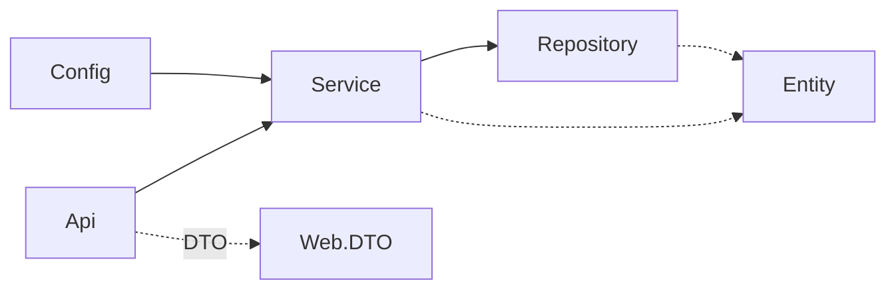
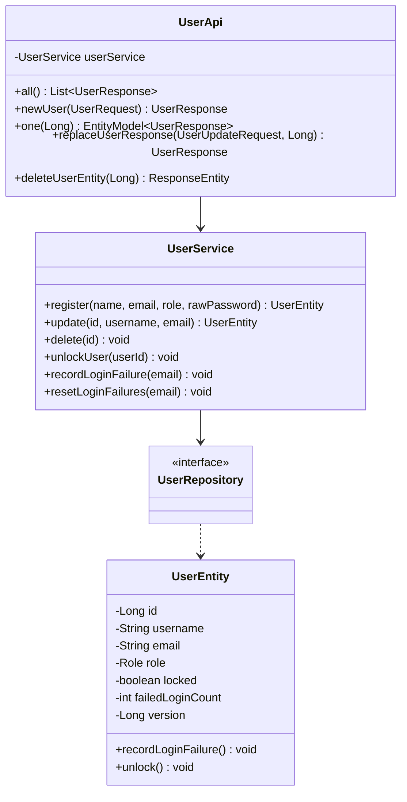
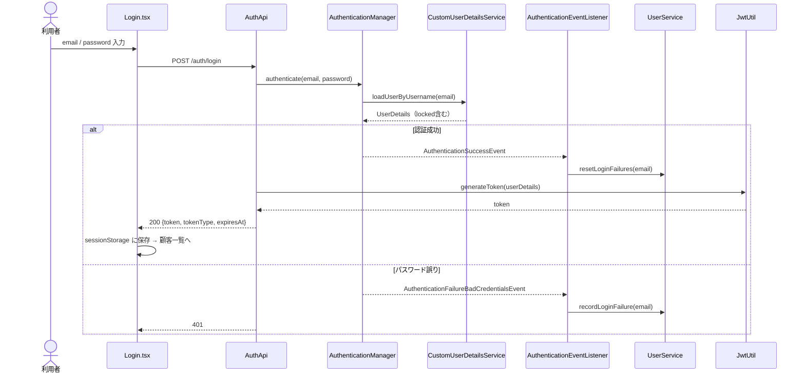
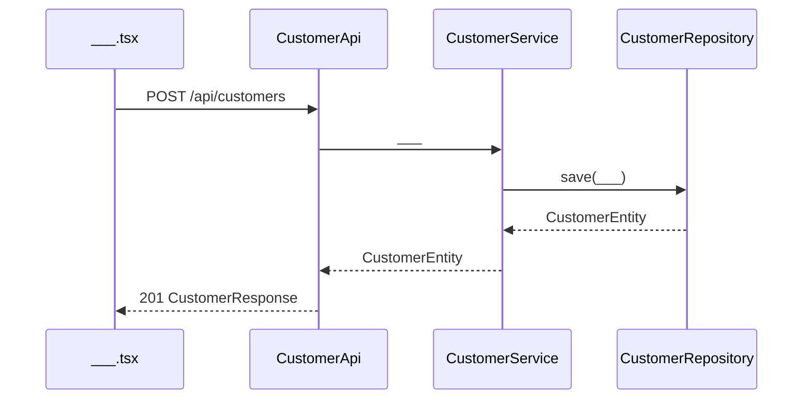

# 詳細設計書 — 顧客管理CRM

| 項目 | 内容 |
|---|---|
| 文書バージョン | 0.1（雛形） |
| 作成日 | YYYY-MM-DD |
| 作成者 | （あなたの名前） |
| 関連文書 | 要件定義書 v0.1（RDD.md） / 基本設計書 v0.1（BD.md） |
| 更新履歴 | 0.1: 雛形作成 |

> **この雛形の使い方**
> - 各章の冒頭にある「📝 書くこと」を読み、表やプレースホルダ `___` を埋めていきます。
> - 各章末尾の「← BD」は、基本設計書のどこを材料にするかの対応です。迷ったらそこを開いてください。
> - 基本設計が「ユーザーから見える部分（外部設計）」だったのに対し、詳細設計は「プログラムの中身（内部設計）」を決める工程です。
>   **この文書を読めば、別の人が同じコードを書ける**状態がゴールです。
> - 記入例は、すでに実装済みの **ログイン（F-001）** と **ユーザー管理（F-023）** を使っています。未実装の機能（顧客・問い合わせ・タグ等）は同じ形式で `___` を埋めてください。
> - 書く順番のおすすめ：2章（構成）→ 6章（DB物理）→ 5章（API）→ 4章（機能）→ 3章（クラス）→ 8章（共通処理）→ 残り。

---

## 1. はじめに

📝 **書くこと**：この文書の対象範囲・前提・用語。基本設計書と重複する内容は書かず、参照で済ませる。

### 1.1 目的
基本設計書（BD.md）で定めた外部仕様を、実装可能な粒度（パッケージ・クラス・メソッド・SQL・処理手順）に落とし込む。

### 1.2 対象範囲
| 区分 | 対象 | 備考 |
|---|---|---|
| バックエンド | `backend/`（Spring Boot） | 本書の中心 |
| フロントエンド | `frontend/`（React + TypeScript） | 7章で扱う |
| DB | `backend/src/main/resources/db/migration/`（Flyway） | 6章で扱う |
| インフラ | `main.tf`（Terraform） | ___（本書の対象外とするか決める） |

### 1.3 前提となる技術スタック（バージョン）
| 区分 | 技術 | バージョン | 根拠ファイル |
|---|---|---|---|
| 言語 | Java | 25 | `backend/pom.xml` の `java.version` |
| FW | Spring Boot | 4.1.1 | `backend/pom.xml` の parent |
| 認証 | Spring Security + JWT（jjwt） | ___ | `backend/pom.xml` |
| ORM | Spring Data JPA / Hibernate | （Boot管理） | |
| マイグレーション | Flyway | （Boot管理） | |
| DB | MySQL | ___ | `application.properties` の `DB_URL` |
| フロント | React / TypeScript / Vite | ___ | `frontend/package.json` |
| APIクライアント | openapi-fetch | ___ | `frontend/src/lib/apiClient.ts` |
| テスト | JUnit 5 / ArchUnit / Vitest | ___ | |

### 1.4 用語（詳細設計で新たに出てくるもの）
| 用語 | 意味 |
|---|---|
| Entity | DBの1行に対応するJavaクラス（例：`UserEntity`） |
| DTO | API の入出力専用のクラス（例：`UserRequest` / `UserResponse`）。Entity を直接外に出さないために使う |
| Service | 業務手順とトランザクション境界を持つ層 |
| Repository | DBアクセスだけを担う層（Spring Data JPA のインターフェース） |
| ___ | ___ |

← **BD**：1章 システム概要・全体構成

---

## 2. ソフトウェア構成

📝 **書くこと**：パッケージ（フォルダ）の分け方、各層の責務、層どうしの依存ルール、命名規約。ここが決まるとクラス設計（3章）の置き場所が自動的に決まる。

### 2.1 パッケージ構成（バックエンド）
ルートパッケージ：`com.example.crm`

| パッケージ | 責務 | 現在のクラス例 | 今後追加するクラス例 |
|---|---|---|---|
| `Api` | HTTPの入口。DTOを受け取りServiceを呼び、DTOに詰め替えて返す | `AuthApi`, `UserApi` | `CustomerApi`, `InquiryApi`, `TagApi` |
| `Service` | 業務手順・トランザクション・メソッド単位の認可（`@PreAuthorize`） | `UserService`, `CustomUserDetailsService` | `CustomerService`, ___ |
| `Repository` | DBアクセス（Spring Data JPA） | `UserRepository` | `CustomerRepository`, ___ |
| `Entity` | テーブルに対応するクラスと、自分の状態を変える振る舞い | `UserEntity` | `CustomerEntity`, ___ |
| `Enum` | コード値（10章） | `Role` | `InquiryStatus` |
| `Web.DTO` | APIの入出力の型 | `UserRequest`, `LoginResponse` 等 | `CustomerRequest`, ___ |
| `Config` | Spring 設定・セキュリティ部品 | `SecurityConfig`, `JwtUtil`, `JwtAuthenticationFilter` 等 | ___ |
| `Exception` | 業務例外と例外→HTTPステータスの変換 | `UserEntityNotFoundException`, `UserEntityNotFoundAdvice` | `GlobalExceptionHandler`（8.4） |

> 現在コード中に「将来 domain 層に移動」「将来 infrastructure/security に分類」というコメントがある。パッケージ再編を行うかどうかは 12章（課題）で決める：___

### 2.2 層の依存ルール


| ルール | 理由 | 自動検査 |
|---|---|---|
| 依存は `Api → Service → Repository` の一方向 | 層を単独で差し替え・テストできるようにする | `ArchitectureTests.layerDependenciesAreRespected` |
| `Repository` を呼べるのは `Service` だけ | DBアクセスとトランザクションを Service に集約する | 同上 |
| パッケージ間の循環依存を禁止 | ___ | `ArchitectureTests.packagesShouldBeFreeOfCycles` |
| Entity を API のレスポンスに直接出さない | `password_hash` 等の漏洩防止（DTOで落とす） | ___（検査を追加するか） |
| ___ | ___ | ___ |

### 2.3 命名規約
| 対象 | 規約 | 例 |
|---|---|---|
| コントローラ | `<名詞>Api` | `UserApi` |
| サービス | `<名詞>Service` | `UserService` |
| リポジトリ | `<名詞>Repository` | `UserRepository` |
| エンティティ | `<名詞>Entity` | `UserEntity` |
| 入力DTO | `<名詞>Request` / 更新用は `<名詞>UpdateRequest` | `UserRequest`, `UserUpdateRequest` |
| 出力DTO | `<名詞>Response` | `UserResponse` |
| 業務例外 | `<名詞><状況>Exception` | `UserEntityNotFoundException` |
| テーブル / 列 | スネークケース・複数形 / スネークケース | `users` / `failed_login_count` |
| Javaフィールド | キャメルケース | `failedLoginCount`（※現状 `failed_login_count` が混在。12章参照） |
| マイグレーション | `V<連番>__<内容>.sql` | `V1__create_users_table.sql` |

### 2.4 フロントエンド構成
| ディレクトリ | 責務 | 現在のファイル例 |
|---|---|---|
| `src/views/` | 画面（SCR-xx に1対1対応） | `Signin/Login.tsx`, `register/UserForm.tsx`, `Top.tsx` |
| `src/components/` | 再利用部品 | `Button.tsx`, `Header.tsx`, `SectionTitle.tsx` |
| `src/lib/` | API クライアント・トークン管理 | `apiClient.ts` |
| `src/types/` | OpenAPI から生成した型 | `api.d.ts` |
| `src/test/` | 画面単位のテスト | `login/Login.test.tsx` |

← **BD**：1.2 システム全体構成

---

## 3. クラス設計

📝 **書くこと**：クラスの一覧と、主要クラスのフィールド・メソッド。メソッドは「シグネチャ・役割・トランザクション・権限」をセットで書く。

### 3.1 クラス一覧
| No | パッケージ | クラス名 | 種別 | 責務（1行） | 対応機能ID |
|---|---|---|---|---|---|
| 1 | Api | `AuthApi` | RestController | ログインとJWT発行 | F-001 |
| 2 | Api | `UserApi` | RestController | ユーザーのCRUD | F-023 |
| 3 | Service | `UserService` | Service | ユーザー登録・更新・削除・ロック制御 | F-001, F-023 |
| 4 | Service | `CustomUserDetailsService` | Service | email からログイン用ユーザーを読み込む | F-001 |
| 5 | Config | `JwtUtil` | Component | トークン生成・検証・クレーム取得 | F-001 |
| 6 | Config | `JwtAuthenticationFilter` | Filter | リクエストごとの Bearer トークン検証 | 全API |
| 7 | Config | `AuthenticationEventListener` | Component | 認証成功/失敗イベントで失敗回数を更新 | F-001 |
| 8 | Config | `AdminBootstrap` | Component | 初回起動時の管理者作成 | ― |
| 9 | ___ | `CustomerApi` | RestController | ___ | F-003〜F-007 |
| 10 | ___ | ___ | ___ | ___ | ___ |

### 3.2 クラス図

（顧客・問い合わせ・タグのクラスも同じ形で追記する：___）

### 3.3 クラス詳細（記入例：`UserService`）
| メソッド | 引数 | 戻り値 | 処理概要 | `@Transactional` | 権限 | 送出する例外 |
|---|---|---|---|---|---|---|
| `register` | name, email, role, rawPassword | `UserEntity` | パスワードをbcryptでハッシュ化しINSERT | ___ | ADMIN（URLで制御） | メール重複→___ |
| `update` | id, username, email | `UserEntity` | 取得→書き換え→保存 | ○ | ___ | 対象なし→`UserEntityNotFoundException` |
| `delete` | id | void | 論理削除（`@SQLDelete`） | ○ | ADMIN（URLで制御） | 対象なし→___ |
| `unlockUser` | userId | void | `UserEntity.unlock()` を呼ぶ | ○ | ADMIN（`@PreAuthorize`） | 対象なし→___ |
| `recordLoginFailure` | email | void | 失敗回数+1、3回でロック | ○ | ― | ― |
| `resetLoginFailures` | email | void | 失敗回数を0に戻す | ○ | ― | ― |

### 3.4 クラス詳細（テンプレート：`___Service`）
| メソッド | 引数 | 戻り値 | 処理概要 | `@Transactional` | 権限 | 送出する例外 |
|---|---|---|---|---|---|---|
| ___ | ___ | ___ | ___ | ___ | ___ | ___ |

← **BD**：3章 機能設計 / 6章 共通方式設計（認可）

---

## 4. 機能詳細設計

📝 **書くこと**：BD 3章の機能ごとに「処理の手順」を番号付きで書き、シーケンス図で層の流れを示す。分岐・例外も手順の中に書く。1機能＝1節。

### 4.1 F-001 ログイン（記入例）

**概要**：email とパスワードを検証し、成功したら JWT を返す。3回連続失敗でアカウントをロックする。

**シーケンス図**


**処理手順**
| No | 処理 | 担当クラス | 補足 |
|---|---|---|---|
| 1 | リクエストボディを `LoginRequest` にバインドし `@Valid` で検証 | `AuthApi` | 未入力→400 |
| 2 | `AuthenticationManager.authenticate()` に email / password を渡す | `AuthApi` | 照合を自前で書かない |
| 3 | email でユーザーを検索（論理削除済みは `@SQLRestriction` で除外） | `CustomUserDetailsService` | 該当なし→401 |
| 4 | ロック中なら `LockedException` | Spring Security | →401（文言は9章） |
| 5 | bcrypt でパスワード照合 | `PasswordEncoder` | 不一致→失敗イベント |
| 6 | 失敗：失敗回数+1、3回でロック・ロック時刻を記録 | `UserEntity.recordLoginFailure()` | |
| 7 | 成功：失敗回数を0に戻す | `UserService.resetLoginFailures()` | |
| 8 | JWT を生成（有効期限 24時間 = `jwt.expiration`） | `JwtUtil` | |
| 9 | `LoginResponse` を返す | `AuthApi` | |

**例外・分岐**
| 条件 | HTTP | メッセージID（9章） | 備考 |
|---|---|---|---|
| email / password 未入力 | 400 | ___ | |
| email 不一致・パスワード不一致 | 401 | ___ | どちらが違うかは返さない（列挙攻撃対策） |
| ロック中 | 401 | ___ | ___（ロック中であることを伝えるか決める） |

### 4.2 F-002 ログアウト
**概要**：___
**シーケンス図**：___
**処理手順**
| No | 処理 | 担当クラス | 補足 |
|---|---|---|---|
| 1 | ___ | ___ | ブラックリスト方式（8.2）を使う |

### 4.3 F-003 顧客登録（テンプレート）
**概要**：___
**シーケンス図**

**処理手順**
| No | 処理 | 担当クラス | 補足 |
|---|---|---|---|
| 1 | ___ | ___ | ___ |

**例外・分岐**
| 条件 | HTTP | メッセージID | 備考 |
|---|---|---|---|
| ___ | ___ | ___ | ___ |

> 以降、BD 3章の機能（F-004〜F-027）について同じ形式で節を追加する。
> 特に設計判断が必要な機能：F-005（二重削除の扱い）、F-004/F-009（楽観ロックの409）、F-026（CSV一括取込のトランザクション）、F-024（バッジ集計のクエリ）。

← **BD**：3章 機能設計

---

## 5. API詳細設計

📝 **書くこと**：BD 5章の1行を、1エンドポイント＝1節に展開する。項目ごとの型・必須・桁数・ステータスコードまで決める。

### 5.0 API共通仕様
| 項目 | 内容 |
|---|---|
| ベースURL | ___（BDは `/api/...`、現行実装は `/auth/login`, `/users`。12章で統一） |
| 形式 | `application/json; charset=UTF-8`（CSVのみ `text/csv` / `multipart/form-data`） |
| 認証 | `Authorization: Bearer <token>`（`/auth/login` 以外すべて） |
| 日時形式 | ISO 8601（例：`2026-06-14T10:00:00Z`） |
| ページング | `page`（0始まり/1始まり：___）, `size` 固定20 |
| エラー形式 | 8.4 の統一JSON |

### 5.1 POST /auth/login（記入例）
| 項目 | 内容 |
|---|---|
| 機能ID | F-001 |
| 権限 | なし（`permitAll`） |
| 処理クラス | `AuthApi#login` |

**リクエスト**（`LoginRequest`）
| 項目 | 型 | 必須 | 制約 | 例 |
|---|---|---|---|---|
| email | string | ○ | `@NotBlank` | `taro@example.com` |
| password | string | ○ | `@NotBlank` | `********` |

**レスポンス 200**（`LoginResponse`）
| 項目 | 型 | 説明 |
|---|---|---|
| token | string | JWT |
| tokenType | string | 固定値 `Bearer` |
| expiresAt | string（ISO 8601） | トークンの失効時刻 |

**ステータスコード**
| コード | 条件 |
|---|---|
| 200 | 認証成功 |
| 400 | 入力不足 |
| 401 | 認証失敗・ロック中 |

### 5.2 POST /users（記入例）
| 項目 | 内容 |
|---|---|
| 機能ID | F-023 |
| 権限 | ADMIN |
| 処理クラス | `UserApi#newUser` |

**リクエスト**（`UserRequest`）
| 項目 | 型 | 必須 | 制約 | 例 |
|---|---|---|---|---|
| username | string | ○ | 10〜50文字 | ___ |
| email | string | ○ | `@NotBlank`（※`@Email` 未付与。12章） | ___ |
| role | string | ○ | `SALES` / `SUPPORT` / `ADMIN` | `SALES` |
| rawPassword | string | ○ | 8文字以上 | ___ |

**レスポンス 201**（`UserResponse`）
| 項目 | 型 | 説明 |
|---|---|---|
| id | number | |
| username | string | |
| email | string | |
| role | string | |
| locked | boolean | |
| createdAt | string | |

**ステータスコード**：201 / 400 / 401 / 403 / 409（メール重複：___）

### 5.3 （テンプレート）___ ___
| 項目 | 内容 |
|---|---|
| 機能ID | ___ |
| 権限 | ___ |
| 処理クラス | ___ |

**リクエスト**
| 項目 | 型 | 必須 | 制約 | 例 |
|---|---|---|---|---|
| ___ | ___ | ___ | ___ | ___ |

**レスポンス ___**
| 項目 | 型 | 説明 |
|---|---|---|
| ___ | ___ | ___ |

**ステータスコード**：___

> BD 5章 No.1〜28 の全エンドポイントについて節を追加する。OpenAPI定義（`frontend/src/types/api.d.ts` の生成元）を正とする場合は、その所在を記載：___

← **BD**：5章 外部インターフェース設計

---

## 6. データベース物理設計

📝 **書くこと**：BD 4章（論理）を、実際の DDL に落とす。型・制約・インデックス・文字コード・マイグレーションの順番まで決める。

### 6.1 共通方針
| 項目 | 方針 |
|---|---|
| DBMS | MySQL ___ |
| エンジン / 文字コード | InnoDB / utf8mb4 / utf8mb4_0900_ai_ci |
| 主キー | `BIGINT AUTO_INCREMENT` |
| 論理削除 | `is_deleted BOOLEAN NOT NULL DEFAULT FALSE` ＋ Entity に `@SQLDelete` / `@SQLRestriction` |
| 楽観ロック | `version BIGINT NOT NULL DEFAULT 0` ＋ `@Version`（BDでは `updated_at` 案。どちらにするか：___） |
| 日時 | `DATETIME`、タイムゾーンは ___ |
| スキーマ管理 | Flyway。`spring.jpa.hibernate.ddl-auto` は ___（`validate` 推奨。現状 `update`） |

### 6.2 テーブル物理定義

#### users（記入例：`V1__create_users_table.sql` 実装済み）
| 列名 | 型 | NULL | 既定値 | 制約 | Javaフィールド | 備考 |
|---|---|---|---|---|---|---|
| id | BIGINT | NOT NULL | AUTO_INCREMENT | PK | `id` | |
| username | VARCHAR(50) | NOT NULL | | | `username` | BDでは `name` |
| email | VARCHAR(255) | NOT NULL | | UNIQUE `uq_users_email` | `email` | ログインID |
| role | VARCHAR(20) | NOT NULL | | CHECK `chk_users_role` | `role` | 10章 |
| is_deleted | BOOLEAN | NOT NULL | FALSE | | `is_deleted` | |
| password_hash | VARCHAR(255) | NOT NULL | | | `passwordHash` | bcrypt |
| locked | BOOLEAN | NOT NULL | FALSE | | `locked` | |
| failed_login_count | INT | NOT NULL | 0 | | `failed_login_count` | |
| created_at | DATETIME | NOT NULL | CURRENT_TIMESTAMP | | `created_at` | |
| lock_time | ___ | ___ | ___ | | `lockTime` | **Entityにあるが V1 に無い**（12章） |
| version | ___ | ___ | ___ | | `version` | **Entityにあるが V1 に無い**（12章） |

#### customers
| 列名 | 型 | NULL | 既定値 | 制約 | Javaフィールド | 備考 |
|---|---|---|---|---|---|---|
| id | BIGINT | NOT NULL | AUTO_INCREMENT | PK | ___ | |
| company_name | VARCHAR(100) | NOT NULL | | | ___ | |
| contact_person | VARCHAR(50) | NULL | | | ___ | |
| user_id | BIGINT | NOT NULL | | FK→users.id | ___ | 担当営業 |
| is_deleted | BOOLEAN | NOT NULL | FALSE | | ___ | |
| created_at | DATETIME | NOT NULL | CURRENT_TIMESTAMP | | ___ | |
| ___ | ___ | ___ | ___ | ___ | ___ | 楽観ロック列 |

#### inquiries / responses / tags / customer_tags
（上と同じ形式で記入：___）

### 6.3 インデックス設計
| テーブル | インデックス名 | 列 | 種別 | 目的（どのクエリを速くするか） |
|---|---|---|---|---|
| users | uq_users_email | email | UNIQUE | ログイン時の email 検索 |
| customers | ___ | company_name | ___ | F-019 キーワード検索（※前方一致以外の `LIKE` は効かない点に注意） |
| inquiries | ___ | (customer_id, status) | ___ | F-010 / F-020 / F-024 |
| ___ | ___ | ___ | ___ | ___ |

### 6.4 外部キーと削除時の動作
| 子テーブル.列 | 親テーブル.列 | ON DELETE | 理由 |
|---|---|---|---|
| customers.user_id | users.id | RESTRICT | 論理削除のため物理削除は発生しない想定 |
| customer_tags.tag_id | tags.id | ___ | F-017 タグ削除時の関連の扱い |
| ___ | ___ | ___ | ___ |

### 6.5 マイグレーション計画
| バージョン | ファイル名 | 内容 | 状態 |
|---|---|---|---|
| V1 | `V1__create_users_table.sql` | users 作成 | 済 |
| V2 | `V2_____.sql` | users に lock_time / version 追加 | 未 |
| V3 | `V3__create_customers_table.sql` | ___ | 未 |
| ___ | ___ | ___ | ___ |

> ルール：適用済みのマイグレーションファイルは**編集しない**（チェックサム不一致で起動失敗する）。変更は必ず新しいバージョンで追加する。

← **BD**：4章 データベース設計（論理）

---

## 7. 画面詳細設計（フロントエンド）

📝 **書くこと**：BD 2章の画面ごとに、コンポーネント構成・状態・呼ぶAPI・入力チェック・遷移を決める。

### 7.1 ルーティング
| パス | 画面ID | コンポーネント | 認証要否 |
|---|---|---|---|
| `/login` | SCR-01 | `views/Signin/Login.tsx` | 不要 |
| `/` | SCR-02 | ___（現在 `views/Top.tsx`） | 要 |
| `/customers/:id` | SCR-03 | ___ | 要 |
| `/users/new` | SCR-09 | `views/register/UserForm.tsx` | 要（ADMIN） |
| ___ | ___ | ___ | ___ |

### 7.2 認証トークンの扱い
| 項目 | 方針 | 実装箇所 |
|---|---|---|
| 保存先 | `sessionStorage`（タブを閉じると消える） | `lib/apiClient.ts` |
| 付与 | 全リクエストに `Authorization: Bearer` を自動付与 | `api.use({ onRequest })` |
| 401 受信時 | トークン削除→ `/login` へ遷移（ログインAPI自身の401は除く） | `api.use({ onResponse })` |
| 権限によるボタン出し分け | ___（ロールをどこから取得するか：JWTのクレーム / `/users/me` API 等） | ___ |

### 7.3 画面詳細（記入例：SCR-01 ログイン）
| 項目 | 内容 |
|---|---|
| コンポーネント | `Login.tsx` |
| 状態（state） | email, password, エラーメッセージ, 送信中フラグ |
| 呼び出すAPI | `POST /auth/login` |
| 入力チェック（フロント） | 未入力チェック（バックを正とする） |
| 成功時 | `setToken()` → SCR-02 へ遷移 |
| 失敗時 | 9章 MSG-___ を表示 |
| テスト | `test/login/Login.test.tsx` |

### 7.4 画面詳細（テンプレート：SCR-___ ___）
| 項目 | 内容 |
|---|---|
| コンポーネント | ___ |
| 状態（state） | ___ |
| 呼び出すAPI | ___ |
| 入力チェック（フロント） | ___ |
| 成功時 | ___ |
| 失敗時 | ___ |
| テスト | ___ |

← **BD**：2章 画面設計

---

## 8. 共通処理詳細設計

📝 **書くこと**：BD 6章の「方針」を、どのクラス・どの設定で実現するかに落とす。

### 8.1 認証（JWT）
| 項目 | 設計値 | 実装箇所 |
|---|---|---|
| 署名アルゴリズム | ___（`JwtUtil#getSigningKey` の鍵長で決まる） | `JwtUtil` |
| 秘密鍵 | 環境変数 `JWT_SECRET` | `application.properties` |
| 有効期限 | 86,400,000 ms（24時間） | `jwt.expiration` |
| subject | email | `JwtUtil#generateToken` |
| 追加クレーム | ___（role を入れるか） | |
| 検証タイミング | 全リクエスト、`UsernamePasswordAuthenticationFilter` の前 | `SecurityConfig` |
| セッション | STATELESS | `SecurityConfig` |
| 未認証時の応答 | 401（`HttpStatusEntryPoint`） | `SecurityConfig` |

### 8.2 ログアウト（トークン失効・ブラックリスト）
BD 6章で「詳細設計にて」とされた事項。
| 項目 | 設計 |
|---|---|
| 保存先 | ___（DBテーブル / インメモリ / Redis） |
| 保存する値 | ___（トークン全体 / `jti` クレーム） |
| 保持期間 | トークンの有効期限まで。期限後は ___ で削除 |
| 検査箇所 | `JwtAuthenticationFilter` |
| スケールアウト時の考慮 | ___（インメモリだと複数台で共有できない。BD 7章 拡張性） |

### 8.3 認可
| 方式 | 使い所 | 例 |
|---|---|---|
| URL単位（`SecurityFilterChain`） | ロールだけで決まるもの | `POST /users` → ADMIN |
| メソッド単位（`@PreAuthorize`） | Service の業務操作 | `UserService#unlockUser` → ADMIN |
| データ単位 | 「自分の担当顧客だけ」等 | ___（必要か決める） |

**ロール×API 権限表**（BD 6章を API に展開）
| API | SALES | SUPPORT | ADMIN |
|---|---|---|---|
| POST /users | × | × | ○ |
| DELETE /users/{id} | × | × | ○ |
| PUT /users/{id}/unlock | × | × | ○ |
| POST /api/customers | ○ | × | ___ |
| ___ | ___ | ___ | ___ |

### 8.4 例外処理
| 例外クラス | HTTP | 変換箇所 | 備考 |
|---|---|---|---|
| `MethodArgumentNotValidException` | 400 | ___ | 複数項目を `errors` 配列で返す（BD 6章） |
| `AuthenticationException` | 401 | Spring Security | |
| `AccessDeniedException` | 403 | Spring Security | |
| `UserEntityNotFoundException` | 404 | `UserEntityNotFoundAdvice` | 他Entityも同様に作るか、共通の `NotFoundException` にまとめるか：___ |
| `ObjectOptimisticLockingFailureException` | 409 | ___ | 二重更新 |
| `DataIntegrityViolationException` | 409 | ___ | メール重複・タグ名重複 |
| `Exception`（その他） | 500 | ___ | スタックトレースはログのみ |

**統一エラーレスポンス**（BD 6章の形式を実装する型）
```java
// 例：Web.DTO.ErrorResponse（新規作成）
public record ErrorResponse(
    Instant timestamp,
    int status,
    String error,
    String message,
    String path,
    List<FieldError> errors   // 400 のときのみ
) {
    public record FieldError(String field, String message) {}
}
```
> 方針：`@RestControllerAdvice` を1つ（`GlobalExceptionHandler`）にまとめるか、例外ごとに分けるか：___

### 8.5 トランザクション
| 項目 | 方針 |
|---|---|
| 境界 | Service のメソッド単位 |
| アノテーション | ___（`jakarta.transaction.Transactional` / `org.springframework...Transactional` のどちらかに統一。ArchitectureTests で検査中） |
| 読み取り専用 | 参照系は `readOnly = true` を付けるか：___ |
| OSIV | 無効（`spring.jpa.open-in-view=false`）。遅延ロードは Service 内で完結させる |

### 8.6 ログ
| 項目 | 設計値 | 実装箇所 |
|---|---|---|
| 形式 | JSON（logstash 形式） | `logging.structured.format.*` |
| 出力先 | コンソール＋ `logs/app.log` | `application.properties` |
| レベル | root=INFO, `com.example.crm`=DEBUG（本番は .env で上書き） | 同上 |
| 監査ログ項目 | time, level, userId, action, path | ___（MDC / AOP / 明示的なlog呼び出し） |
| 監査対象 action 値 | `LOGIN_SUCCESS`, `LOGIN_FAILURE`, `DELETE_CUSTOMER`, `CREATE_USER`, `UPDATE_USER`, `UNLOCK_USER`, ___ | |
| マスク対象 | password, rawPassword, passwordHash, token, Authorization ヘッダ | ___ |
| ローテーション・保管 | 5年（RDD） | ___ |

### 8.7 入力バリデーション
| 項目 | 方針 |
|---|---|
| 実装 | Bean Validation（DTO に `@NotBlank` / `@Size` / `@Email` 等） |
| 基準 | 6章の列定義（桁数・NOT NULL）と一致させる |
| エラーメッセージ | アノテーションの `message` 属性で日本語指定（9章のIDと対応） |
| 相関チェック | ___（例：存在する user_id か → Service で検査） |

← **BD**：6章 共通方式設計

---

## 9. メッセージ一覧

📝 **書くこと**：画面・APIに出る文言をIDで一元管理する。コードとテストはIDで参照する。

| メッセージID | 種別 | 文言 | 使用箇所 |
|---|---|---|---|
| MSG-I-001 | 情報 | ログインしました。 | F-001 |
| MSG-E-001 | エラー | メールアドレスまたはパスワードが正しくありません。もう一度入力してください。 | F-001 |
| MSG-E-002 | エラー | Emailは必須です。 | `LoginRequest`, `UserRequest` |
| MSG-E-003 | エラー | パスワードが未入力です。 | `LoginRequest`, `UserRequest` |
| MSG-E-___ | エラー | 会社名は必須です | F-003 |
| MSG-I-___ | 情報 | 登録しました | F-003, F-008 |
| ___ | ___ | ___ | ___ |

← **BD**：6章 例外処理（メッセージ方針）

---

## 10. コード値一覧

📝 **書くこと**：Enum として持つ値。DBの格納値・画面の表示名・Javaの定数名を対応させる。

### 10.1 Role（ユーザー権限）— `Enum.Role`
| Java定数 / DB値 | 表示名 |
|---|---|
| `SALES` | 営業担当者 |
| `SUPPORT` | カスタマーサポート |
| `ADMIN` | 管理者 |

### 10.2 InquiryStatus（問い合わせステータス）— 新規作成
| Java定数 / DB値 | 表示名 | 遷移可能な次ステータス |
|---|---|---|
| `NEW` | 新規 | ___ |
| `IN_PROGRESS` | 対応中 | ___ |
| `ON_HOLD` | 保留 | ___ |
| `DONE` | 完了 | ___ |

> BD 4章では `status` の既定値を「新規」（日本語）としている。DBに日本語を入れるか英字コードにするか：___

← **BD**：4.2 テーブル定義 / 3章 F-014

---

## 11. テスト設計（単体・結合）

📝 **書くこと**：どの層を、どの種類のテストで、どこまで確認するか。テストケースの観点を機能ごとに列挙する。

### 11.1 テスト方針
| 層 | テスト種別 | ツール | 既存テスト |
|---|---|---|---|
| Entity | 単体（振る舞い） | JUnit 5 | `UserEntityTests` |
| Service | 単体 / 結合 | JUnit 5 + ___ | `UserServiceTests` |
| Api | Web層テスト（MockMvc 等） | ___ | ___ |
| Security | JWT・認可 | JUnit 5 | `JwtSystemTests`, `PasswordEncoderTests` |
| アーキテクチャ | 依存ルール | ArchUnit | `ArchitectureTests` |
| フロント | コンポーネント | Vitest + Testing Library | `Login.test.tsx`, `register.test.tsx` |
| DB | ___（H2 か Testcontainers(MySQL) か） | ___ | ― |

### 11.2 テスト観点（記入例：F-001 ログイン）
| No | 観点 | 入力・前提 | 期待結果 | 対応テスト |
|---|---|---|---|---|
| 1 | 正常系 | 正しい email / password | 200・トークン返却・失敗回数0 | ___ |
| 2 | パスワード誤り | 1回失敗 | 401・失敗回数1 | ___ |
| 3 | ロック | 3回連続失敗 | locked=true・lock_time 記録 | `UserEntityTests` |
| 4 | ロック中のログイン | locked=true で正しいパスワード | 401 | ___ |
| 5 | 論理削除済みユーザー | is_deleted=true | 401 | ___ |
| 6 | 未入力 | email 空 | 400 | ___ |
| 7 | トークン期限切れ | 期限切れトークンでAPI呼び出し | 401 | ___ |

### 11.3 テスト観点（テンプレート：F-___）
| No | 観点 | 入力・前提 | 期待結果 | 対応テスト |
|---|---|---|---|---|
| ___ | ___ | ___ | ___ | ___ |

← **BD**：3章 機能設計（例外列）/ 7章 非機能設計

---

## 12. 課題・未決事項・BDとの差分

📝 **書くこと**：詳細設計中に見つかった「決めていないこと」「BDと実装が食い違っていること」を記録し、決着したら決定内容を書く。

| No | 区分 | 内容 | 影響範囲 | 決定内容 | 状態 |
|---|---|---|---|---|---|
| 1 | BD差分 | APIのパスが BD では `/api/auth/login`, `/api/users`、実装では `/auth/login`, `/users` | 5章・フロント | ___ | 未決 |
| 2 | BD差分 | users の氏名列が BD では `name`、DDL では `username` | 4章・6章 | ___ | 未決 |
| 3 | DDL不整合 | `UserEntity` に `lockTime` / `version` があるが V1 の DDL に列が無い（`ddl-auto=update` により暗黙に追加されている可能性） | 6章 | V2 マイグレーションで追加し、`ddl-auto=validate` にする案 | 未決 |
| 4 | 楽観ロック | BD は `updated_at` で競合検知、実装は `@Version` | 6.1 | ___ | 未決 |
| 5 | バリデーション | `UserRequest.email` に `@Email` が無い（`UserUpdateRequest` にはある） | 8.7 | ___ | 未決 |
| 6 | 命名 | Entity フィールドにスネークケース（`is_deleted`, `failed_login_count`, `created_at`）が混在 | 2.3 | ___ | 未決 |
| 7 | 構成 | パッケージを domain / infrastructure に再編するか | 2.1 | ___ | 未決 |
| 8 | ログアウト | ブラックリストの保存先 | 8.2 | ___ | 未決 |
| ___ | ___ | ___ | ___ | ___ | ___ |

---

## 付録

### A. トレーサビリティ（RDD → BD → DD → コード）
| 機能ID | BD画面 | BD API No | DD節 | 主なクラス | テスト |
|---|---|---|---|---|---|
| F-001 | SCR-01 | 1 | 4.1 / 5.1 | `AuthApi`, `JwtUtil` | `JwtSystemTests` |
| F-023 | SCR-09 | 21〜24 | 5.2 | `UserApi`, `UserService` | `UserServiceTests` |
| F-003 | SCR-04 | 4 | 4.3 | ___ | ___ |
| ___ | ___ | ___ | ___ | ___ | ___ |

### B. 関連文書
- 要件定義書（RDD.md）
- 基本設計書（BD.md）
- 変更影響分析（CIA.md）
